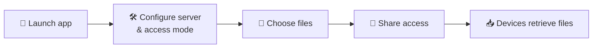

# 🌐 iOnline

### Freedom to share files — independence from existing network infrastructure

Create **public** and **private** file-sharing servers, distribute files of any type, and stay in full control of who can access your data.

 

 

[Features](#-features) •
[Goals](#-project-goals) •
[Roadmap](#-roadmap) •
[Usage](#%EF%B8%8F-usage) •
[Security](#-security) •
[License](#-license)

---

## ✨ Features

| | Feature | Description |
|---|---|---|
| 📁 | **File Distribution** | Share and distribute files of any type. |
| 🌐 | **Public Servers** | Create servers accessible to other users over a network. |
| 🔒 | **Private Servers** | Organize restricted access to shared files. |
| 🖥️ | **Self-Hosted** | Run and manage servers on the devices you already have. |
| 🧩 | **Extensible Architecture** | Designed with future networking capabilities in mind. |
| 🛠️ | **Independent Development** | Created and maintained by a single author. |

> [!NOTE]
> Some features may still be under development and might not be available in the current release.

---

## 🎯 Project Goals

The goal of **iOnline** is to provide a simple and flexible way to distribute files **without relying on centralized file-hosting services**.

In the long term, the project aims to go beyond a conventional file server and become a tool for **local data sharing and device-to-device communication** — even when traditional network infrastructure is unavailable.

---

## 🚀 Roadmap

### 📂 File Sharing
- [ ] Improve file publishing and distribution mechanisms
- [ ] Implement public and private server management
- [ ] Introduce access control for shared files
- [ ] Improve file transfer performance and reliability

### 📡 Network Interface Management
- [ ] Detect available network interfaces
- [ ] Identify the status and capabilities of network adapters
- [ ] Use available network interfaces to establish connections between devices
- [ ] Develop local device discovery mechanisms

### 📶 Wi-Fi and Offline Networking
- [ ] Enable Wi-Fi network creation using compatible wireless adapters
- [ ] Establish local networks for direct file sharing between devices
- [ ] Support operation without an external router or existing access point *(where supported by hardware and OS)*
- [ ] Explore direct device-to-device connectivity and decentralized file distribution

> [!IMPORTANT]
> **Long-term vision:** make iOnline a tool for sharing files between devices even when there is no internet connection or pre-existing Wi-Fi network.

> [!NOTE]
> The implementation of wireless networking features will depend on hardware capabilities, driver support, and operating system limitations.

---

## 📦 Installation

Installation instructions will be added once the project's setup process and distribution method have been established.

In the meantime, you can explore the source code and review the project's requirements as they become available.

---

## ⚙️ Usage

The intended iOnline workflow:

1. **Launch** the application on your device.
2. **Configure** a server and select its access mode (public or private).
3. **Choose** the files you want to share.
4. **Provide** other users with access to the server.
5. **Allow** other devices to retrieve the shared files over an available network connection.

> Detailed setup instructions and command-line examples will be documented as the project evolves.

---

## 🔐 Security

Keep the following in mind when using iOnline:

- ⚠️ Avoid exposing confidential data through public servers without appropriate protection.
- 🔑 Restrict access to private servers using authentication and authorization mechanisms when available.
- 🧱 Consider firewall rules and network port accessibility.
- 🚫 Avoid exposing system directories or files that are not intended for distribution.

> [!WARNING]
> A public server may make shared files accessible to other users. Server owners are responsible for selecting the files they distribute and configuring access appropriately.

---

## 👨‍💻 Development

iOnline is independently developed and maintained by a single author.

The project is being built incrementally — starting with core file-server functionality and gradually expanding toward more advanced networking and offline data-sharing capabilities. Features and priorities may evolve as development progresses and new technical possibilities are explored.

---

## 📄 License

iOnline is distributed under the **MIT License**.

See the [LICENSE](LICENSE) file for the full license text. The MIT License permits use, copying, modification, merging, publishing, distribution, sublicensing, and sale of copies of the software, subject to its terms and conditions.

---

## 🌱 Vision

The project aims to bring **file serving**, **access management**, and future **local wireless networking** together in a single tool — enabling users to exchange data wherever technically possible, regardless of whether an internet connection is available.

 

**iOnline** — freedom to share files and independence from existing network infrastructure.

Created and maintained by the project author · © iOnline · Licensed under the MIT License

